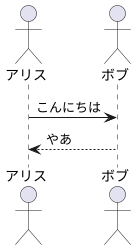
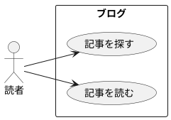
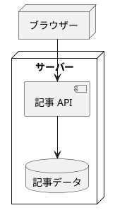
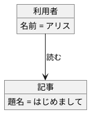
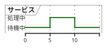
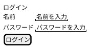
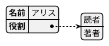
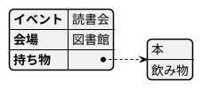
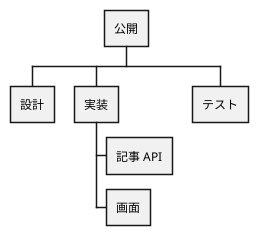
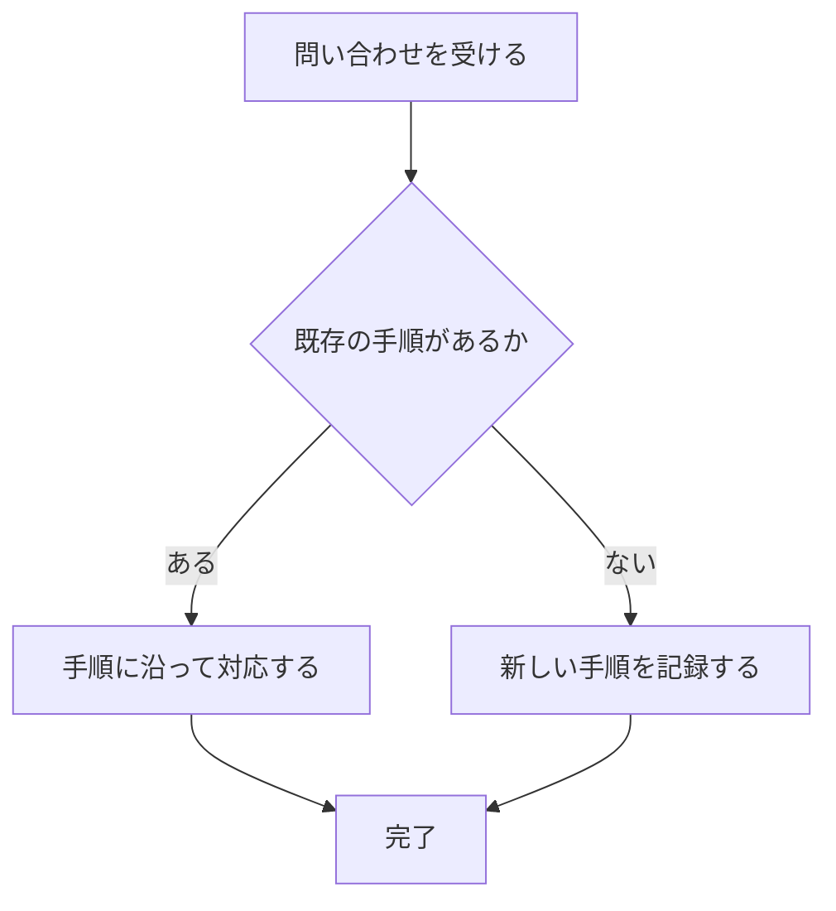

Markdown の各種構文とこのブログでの現在の表示を確認できるサンプルページです。  
各節では Markdown の記法とその現在の表示を確認することができます。

## 見出し

見出しは H1 から H6 まで書くことができます。\
ただし、目次として扱われるのは H2 から H4 までとなっているので注意してください。

# H1 見出し

## H2 見出し

### H3 見出し

#### H4 見出し

##### H5 見出し

###### H6 見出し

<details>
<summary>記法</summary>

```text
# H1 見出し

## H2 見出し

### H3 見出し

#### H4 見出し

##### H5 見出し

###### H6 見出し
```

</details>

## 目次

H2, H3, H4 の見出しを対象に目次が自動で生成されます。\
H1 を使っても目次には反映されないので注意してください。

## 本文と段落

これは通常の段落です。Markdown では、空行を挟むことで別の段落として扱われます。

これは別の段落です。日本語の長い本文、英数字、インラインコードなどが混在したときの行間や折り返しを示す文章です。たとえば、123, ABC, `README.md` といったものです。

<details>
<summary>記法</summary>

```text
これは通常の段落です。Markdown では、空行を挟むことで別の段落として扱われます。

これは別の段落です。日本語の長い本文、英数字、インラインコード、リンクなどが混在したときの行間や折り返しを示す文章です。たとえば `README.md`、`CONTRIBUTING.md`、`docs/guide.md` などのファイル名を含めています。
```

</details>

## 改行

各種改行です。

通常の Markdown ファイルでは、単なる改行は同じ段落として扱われます。
この行は前の行と同じ段落として表示されます。

<details>
<summary>記法</summary>

```text
通常の Markdown ファイルでは、単なる改行は同じ段落として扱われます。
この行は前の行と同じ段落として表示されます。
```

</details>

行末に半角スペースを2つ入れる改行です。
`␠` は半角スペースを表します。

行末に2つのスペースを入れた改行です。  
次の行に分かれます。

<details>
<summary>記法</summary>

```text
行末に2つのスペースを入れた改行です。␠␠
次の行に分かれます。
```

</details>

行末にバックスラッシュを入れる改行です。

行末にバックスラッシュを入れた改行です。\
次の行に分かれます。

<details>
<summary>記法</summary>

```text
行末にバックスラッシュを入れた改行です。\
次の行に分かれます。
```

</details>

HTML の `<br>` を使う改行です。

HTML の `<br>` を使う改行です。<br>
次の行に分かれます。

<details>
<summary>記法</summary>

```text
HTML の `<br>` を使う改行です。<br>
次の行に分かれます。
```

</details>

空行を挟むと別段落となります。

空行を挟むと別段落です。

これは別段落です。

<details>
<summary>記法</summary>

```text
空行を挟むと別段落です。

これは別段落です。
```

</details>

## テキストのスタイル

通常のテキストに対するスタイルです。

| 種類               | Markdown                 | 表示                   |
| ------------------ | ------------------------ | ---------------------- |
| 太字               | `**太字**`               | **太字**               |
| 斜体               | `_斜体_`                 | _斜体_                 |
| 取り消し線         | `~~削除済み~~`           | ~~削除済み~~           |
| 太字と斜体の入れ子 | `**非常に _重要_ です**` | **非常に _重要_ です** |
| 太字かつ斜体       | `***重要な強調***`       | **_重要な強調_**       |
| 下付き             | `<sub>下付き</sub>`      | <sub>下付き</sub>      |
| 上付き             | `<sup>上付き</sup>`      | <sup>上付き</sup>      |
| 下線               | `<ins>下線</ins>`        | <ins>下線</ins>        |

文中でも **太字**、_斜体_、~~取り消し線~~、`inline code`、<sub>sub</sub>、<sup>sup</sup> が混在して表示されます。

## 引用

これは通常のテキストです。

> これは引用です。  
> 複数行の引用です。

> 引用の中で **太字**、_斜体_、`inline code`、[リンク](https://densanken.com) を使う例です。

> ネストした引用の例です。
>
> > これは引用の中の引用です。

<details>
<summary>記法</summary>

```text
> これは引用です。
> 複数行の引用です。

> 引用の中で **太字**、_斜体_、`inline code`、[リンク](https://densanken.com) を使う例です。

> ネストした引用の例です。
>
> > これは引用の中の引用です。
> > > 3
> > > > 4
> > > > > 5
```

</details>

## リスト

順序なしリストです。

- りんご
- みかん
- ぶどう

<details>
<summary>記法</summary>

```text
- りんご
- みかん
- ぶどう
```

</details>

順序付きリストです。

1. 要件を整理する
2. 実装する
3. レビューする
4. マージする

<details>
<summary>記法</summary>

```text
1. 要件を整理する
2. 実装する
3. レビューする
4. マージする
```

</details>

ネストしたリストです。

1. 最初の項目
   - ネストした項目
     - さらにネストした項目
2. 次の項目
   1. 番号付きのネスト
   2. もう1つの番号付きネスト

<details>
<summary>記法</summary>

```text
1. 最初の項目
   - ネストした項目
     - さらにネストした項目
2. 次の項目
   1. 番号付きのネスト
   2. もう1つの番号付きネスト
```

</details>

同じ番号を使った順序付きリストです。

1. 表示上は1番目
1. 表示上は2番目
1. 表示上は3番目

<details>
<summary>記法</summary>

```text
1. 表示上は1番目
1. 表示上は2番目
1. 表示上は3番目
```

</details>

## タスクリスト

タスクリストです。クリックしてチェックを変化させることはできません。

- [x] 完了したタスク
- [ ] 未完了のタスク
- [ ] `code` を含むタスク
- [ ] **強調** を含むタスク
- [ ] [リンク](https://densanken.com) を含むタスク
- [ ] \(Optional) 先頭が括弧のタスク

<details>
<summary>記法</summary>

```text
- [x] 完了したタスク
- [ ] 未完了のタスク
- [ ] `code` を含むタスク
- [ ] **強調** を含むタスク
- [ ] [リンク](https://densanken.com) を含むタスク
- [ ] \(Optional) 先頭が括弧のタスク
```

</details>

## テーブル

基本的なテーブルです。

| 項目      | 型        | 必須 | 説明         |
| --------- | --------- | ---- | ------------ |
| `id`      | `string`  | yes  | 一意な識別子 |
| `name`    | `string`  | yes  | 表示名       |
| `count`   | `number`  | no   | 件数         |
| `enabled` | `boolean` | no   | 有効かどうか |

<details>
<summary>記法</summary>

```text
| 項目      | 型        | 必須 | 説明         |
| --------- | --------- | ---- | ------------ |
| `id`      | `string`  | yes  | 一意な識別子 |
| `name`    | `string`  | yes  | 表示名       |
| `count`   | `number`  | no   | 件数         |
| `enabled` | `boolean` | no   | 有効かどうか |
```

</details>

配置指定付きのテーブルです。

| 左寄せ | 中央寄せ | 右寄せ |
| :----- | :------: | -----: |
| apple  |  orange  |    100 |
| banana |  grape   |  2,000 |
| melon  |  peach   | 30,000 |

<details>
<summary>記法</summary>

```text
| 左寄せ | 中央寄せ | 右寄せ |
| :----- | :------: | -----: |
| apple  |  orange  |    100 |
| banana |  grape   |  2,000 |
| melon  |  peach   | 30,000 |
```

</details>

テーブル内の Markdown 表示です。

| 内容             | 表示                                     |
| ---------------- | ---------------------------------------- |
| 太字             | **重要**                                 |
| インラインコード | `pnpm test`                              |
| リンク           | [CCSホームページ](https://densanken.com) |
| 取り消し線       | ~~古い値~~                               |

<details>
<summary>記法</summary>

```text
| 内容             | 表示                          |
| ---------------- | ----------------------------- |
| 太字             | **重要**                      |
| インラインコード | `pnpm test`                   |
| リンク           | [CCSホームページ](https://densanken.com) |
| 取り消し線       | ~~古い値~~                    |
```

</details>

テーブル内の記号、空セル、長い文章の表示です。

| 内容           | 表示                                                                                                                                |
| -------------- | ----------------------------------------------------------------------------------------------------------------------------------- |
| パイプ文字     | `A \| B`                                                                                                                            |
| 空セル         |                                                                                                                                     |
| HTML 改行      | 1行目<br>2行目                                                                                                                      |
| 長い文章       | 日本語の長い説明文、英数字、`inline code`、括弧付きの補足（追加条件、例外条件、更新日）を同じセルに入れた場合の折り返しを示します。 |
| 参照形式リンク | [CCSホームページ][ccs-homepage]                                                                                                     |

[ccs-homepage]: https://densanken.com

<details>
<summary>記法</summary>

```text
| 内容           | 表示                                                                                                                                  |
| -------------- | ------------------------------------------------------------------------------------------------------------------------------------- |
| パイプ文字     | `A \| B`                                                                                                                              |
| 空セル         |                                                                                                                                       |
| HTML 改行      | 1行目<br>2行目                                                                                                                        |
| 長い文章       | 日本語の長い説明文、英数字、`inline code`、括弧付きの補足（追加条件、例外条件、更新日）を同じセルに入れた場合の折り返しを示します。 |
| 参照形式リンク | [CCSホームページ][ccs-homepage]                                                                                                        |

[ccs-homepage]: https://densanken.com
```

</details>

## コード

インラインコードは、文中で `git status` や `pnpm install` のように表示されます。

複数行のコードは、フェンス付きコードブロックで表現してください。

```sh
git status
git add README.md
git commit -m "docs: update markdown sample"
```

GitHub リンクを用いたコード埋め込みについては、[埋め込み > GitHub](#github) を参照してください。

<details>
<summary>記法</summary>

````text
インラインコードは、文中で `git status` や `pnpm install` のように表示されます。

```sh
git status
git add README.md
git commit -m "docs: update markdown sample"
```
````

</details>

言語指定付きのコードブロックです。

```js
const user = {
  id: "user_001",
  name: "山田太郎",
  role: "member",
};

console.log(`${user.name} の権限は ${user.role ?? "未設定"} です。`);
```

<details>
<summary>記法</summary>

````text
```js
const user = {
  id: "user_001",
  name: "山田太郎",
  role: "member",
};

console.log(`${user.name} の権限は ${user.role ?? "未設定"} です。`);
```
````

</details>

言語指定の後ろに `[ファイル名]` を書くことで、ファイル名を表示することができます。

```go [cmd/hello/main.go]
package main

import "fmt"

func main() {
	fmt.Println("Hello, world!")
}
```

<details>
<summary>記法</summary>

````text
```go [cmd/hello/main.go]
package main

import "fmt"

func main() {
	fmt.Println("Hello, world!")
}
```
````

</details>

言語指定の後ろに `{行番号}` を書くことで、その行を強調することができます。
範囲は `3-4` のように書くことができます。

```py {1,3-4} [fib.py]
def fib(n: int) -> int:
    """n 番目のフィボナッチ数を返す"""
    if n < 2:
        return n
    return fib(n - 1) + fib(n - 2)
```

<details>
<summary>記法</summary>

````text
```py {1,3-4} [fib.py]
def fib(n: int) -> int:
    """n 番目のフィボナッチ数を返す"""
    if n < 2:
        return n
    return fib(n - 1) + fib(n - 2)
```
````

</details>

コードブロック内にバッククォートを含める場合は、外側のバッククォート数を増やしてください。

````md
```rb
puts "コードブロックの中にコードブロックを書く例"
```
````

<details>
<summary>記法</summary>

`````text
````md
```rb
puts "コードブロックの中にコードブロックを書く例"
```
````
`````

</details>

### 行番号

言語指定の後ろに `showLineNumbers` を書くことで、行番号を表示することができます。
`showLineNumbers=10` のように書くと、10 行目から数えられます。\
この記法はファイル名や行の強調と組み合わせることができます。

```rs [src/main.rs] showLineNumbers
fn add(a: i32, b: i32) -> i32 {
    a + b
}

fn main() {
    println!("{}", add(1, 2));
}
```

```cpp {4-5} [src/main.cpp] showLineNumbers=10
#include <iostream>

int main() {
    int total = 0;
    for (int i = 1; i <= 3; ++i) total += i;
    std::cout << total << "\n";
}
```

<details>
<summary>記法</summary>

````text
```rs [src/main.rs] showLineNumbers
fn add(a: i32, b: i32) -> i32 {
    a + b
}
```

```cpp {4-5} [src/main.cpp] showLineNumbers=10
int total = 0;
for (int i = 1; i <= 3; ++i) total += i;
```
````

</details>

### 差分の表示

行末に `// [!code ++]` や `// [!code --]` を書くことで、追加と削除の行として表示することができます。\
また、`// [!code focus]` と書くことで、その行以外を薄く表示することができます。

なお、コメント記号は記述する言語に合わせてください。

```ts
export const greet = (name: string) => {
  return "Hello"; // [!code --]
  return `Hello, ${name}!`; // [!code ++]
};
```

```java
class HelloWorld {
  public static void main(String[] args) { // [!code focus]
    System.out.println("Hello, World!"); // [!code focus]
  } // [!code focus]
}
```

<details>
<summary>記法</summary>

````text
```ts
export const greet = (name: string) => {
  return "Hello"; // [!code --]
  return `Hello, ${name}!`; // [!code ++]
};
```
````

````text
```java
class HelloWorld {
  public static void main(String[] args) { // [!code focus]
    System.out.println("Hello, World!"); // [!code focus]
  } // [!code focus]
}
```
````

</details>

### コードのタブ

連続するコードブロックのメタに `tab` を書くことで、1つのタブにまとめることができます。
タブの名前は `[]` で指定した名前となります。
なお、`tab` を付けないコードブロックを間に置くと別のグループになります。

```sh [npm] tab
npm install nuxt
```

```sh [pnpm] tab
pnpm add nuxt
```

```sh [yarn] tab
yarn add nuxt
```

<details>
<summary>記法</summary>

````text
```sh [npm] tab
npm install nuxt
```

```sh [pnpm] tab
pnpm add nuxt
```

```sh [yarn] tab
yarn add nuxt
```
````

</details>

### シンタックスハイライト

[Shiki](https://shiki.style/) が対応するすべての言語と別名でシンタックスハイライトが適用されます。
以下は一部の例です。

```kt
fun main() {
    println("Hello, world!")
}
```

```swift
let names = ["CCS", "Blog"]
print(names.joined(separator: ", "))
```

```sql
SELECT name, COUNT(*) AS posts
FROM posts
GROUP BY name;
```

```yaml
name: CI
on: [push]
jobs:
  build:
    runs-on: ubuntu-latest
```

```dockerfile
FROM node:26-slim
WORKDIR /app
CMD ["pnpm", "build"]
```

### コピーボタン

コードブロックの右上のボタンで、コードをクリップボードにコピーすることができます。
記述は不要です。

### 折り返し

1行が長いコードの場合、右上の折り返しボタンを用いることでコードの折り返しを切り替えることができます。
記述は不要です。

行番号やハイライトと組み合わせても使うことができます。

```ts {3} [src/patterns.ts] showLineNumbers
// 文字列や正規表現のリテラルは、フォーマッターを通しても途中で改行されません
export const linuxKernelStartUrl = "https://github.com/torvalds/linux/blob/master/init/main.c#L1000-L1100";
export const isoDateTime = /^(?<year>\d{4})-(?<month>0[1-9]|1[0-2])-(?<day>0[1-9]|[12]\d|3[01])T(?<hour>[01]\d|2[0-3]):(?<minute>[0-5]\d):(?<second>[0-5]\d)(?:\.\d+)?(?:Z|[+-](?:[01]\d|2[0-3]):[0-5]\d)$/u;
```

<details>
<summary>記法</summary>

````text
```ts {3} [src/patterns.ts] showLineNumbers
// 文字列や正規表現のリテラルは、フォーマッターを通しても途中で改行されません
export const linuxKernelStartUrl = "https://github.com/torvalds/linux/blob/master/init/main.c#L1000-L1100";
export const isoDateTime = /^(?<year>\d{4})-(?<month>0[1-9]|1[0-2])-(?<day>0[1-9]|[12]\d|3[01])T(?<hour>[01]\d|2[0-3]):(?<minute>[0-5]\d):(?<second>[0-5]\d)(?:\.\d+)?(?:Z|[+-](?:[01]\d|2[0-3]):[0-5]\d)$/u;
```
````

</details>

### Markdown

言語を `md` または `markdown` にしたコードブロックは、上部のタブで「Markdown」（コード）と「プレビュー」（レンダリングした表示）を切り替えることができます。
ただし、常に最初はコードの表示となります。
なお、コピーボタンではどちらの表示であっても元の Markdown がコピーされます。

プレビューでは、GitHub Flavored Markdown（表、タスクリスト、取り消し線、脚注、URL の自動リンク）、GitHub Alerts、数式、シンタックスハイライト付きのコードブロックが使えます。
コードブロックを含める場合は、外側のコードブロックを 4 つ以上の `` ` `` で囲んでください。
一方で、安全のため、次のものはレンダリングされません。

- 画像（代替テキストだけが表示されます）
- HTML のタグ
- 埋め込みとリンクカード（URL は通常のリンクになります）
- アイコンなどの MDC の記法と、絵文字のショートコード（そのままの文字で表示されます）
- Mermaid や PlantUML の図（コードのまま表示されます）

また、プレビューの中の見出しは、記事の見出しと同じ大きさで表示されますが、目次には含まれません。

````md [README.md]
# ほしぞらログ

夜空の観測を記録する、**架空の** _Web アプリ_ です。

> [!NOTE]
> 観測には暗い場所がおすすめです。

## 機能

- [x] 観測した星座を記録する
- [x] 雲の量を 5 段階で入力する
- [ ] ~~望遠鏡を自動で動かす~~

| 等級 | 見え方         |
| ---- | -------------- |
| 1    | 街中でも見える |
| 4    | 郊外なら見える |
| 6    | 暗い空で限界   |

2 つの星の等級と明るさには $m_1 - m_2 = -2.5 \log_{10} \frac{F_1}{F_2}$ の関係があります[^1]。


観測の記録は、次のように取り出せます。

```python
from hoshizora import Log

for entry in Log.load("2026-11.json"):
    print(entry.constellation, entry.magnitude)
```

詳しくは https://example.com/hoshizora-log をご覧ください。

[^1]: 等級が 5 小さいと、明るさは 100 倍になります。
````

<details>
<summary>記法</summary>

`````text
````md [README.md]
# ほしぞらログ

夜空の観測を記録する、**架空の** _Web アプリ_ です。

> [!NOTE]
> 観測には暗い場所がおすすめです。

## 機能

- [x] 観測した星座を記録する
- [x] 雲の量を 5 段階で入力する
- [ ] ~~望遠鏡を自動で動かす~~

| 等級 | 見え方         |
| ---- | -------------- |
| 1    | 街中でも見える |
| 4    | 郊外なら見える |
| 6    | 暗い空で限界   |

2 つの星の等級と明るさには $m_1 - m_2 = -2.5 \log_{10} \frac{F_1}{F_2}$ の関係があります[^1]。


観測の記録は、次のように取り出せます。

```python
from hoshizora import Log

for entry in Log.load("2026-11.json"):
    print(entry.constellation, entry.magnitude)
```

詳しくは https://example.com/hoshizora-log をご覧ください。

[^1]: 等級が 5 小さいと、明るさは 100 倍になります。
````
`````

</details>

## 数式

インライン数式の例です。

$a^2 + b^2 = c^2$

$x = \frac{-b \pm \sqrt{b^2 - 4ac}}{2a}$

<details>
<summary>記法</summary>

```text
$a^2 + b^2 = c^2$

$x = \frac{-b \pm \sqrt{b^2 - 4ac}}{2a}$
```

</details>

ブロック数式の例です。

$$
\sum_{i=1}^{n} i = \frac{n(n + 1)}{2}
$$

<details>
<summary>記法</summary>

```text
$$
\sum_{i=1}^{n} i = \frac{n(n + 1)}{2}
$$
```

</details>

## 画像

画像は著者ディレクトリの `assets/` に置き、記事からの相対パスで参照してください。


<details>
<summary>記法</summary>

```text

```

</details>

`{width="200"}` で表示の幅を指定することができます。

{width="200"}

<details>
<summary>記法</summary>

```text
{width="200"}
```

</details>

タイトルを付けると、キャプションとして表示されます。
記事の画像はクリックすると拡大できます。


<details>
<summary>記法</summary>

```text

```

</details>

## 絵文字 :wave:

`:smile:` のようなショートコードは、絵文字に変換されます。

:smile: :+1: :rocket:

<details>
<summary>記法</summary>

```text
:smile: :+1: :rocket:
```

</details>

## アイコン :icon{name="rocket"}

[Lucide Icons](https://lucide.dev/) を利用することができます。

:icon{name="rocket"} :icon{name="flame"}

:icon{name="square-letter-c" label="C"} :icon{name="square-letter-c" label="C"} :icon{name="square-letter-s" label="S"}

サイズを指定することもできます。\
サイズは `xs`, `sm`, `base`, `lg`, `xl`, `2xl` の6種から選択することができ、指定しない場合は `base` となります。\
なお見出しにサイズ指定はできません。

`xs`: :icon{name="square-letter-a" size="xs"} \
`sm`: :icon{name="square-letter-b" size="sm"} \
`base`: :icon{name="square-letter-c" size="base"} \
`lg`: :icon{name="square-letter-d" size="lg"} \
`xl`: :icon{name="square-letter-e" size="xl"} \
`2xl`: :icon{name="square-letter-f" size="2xl"}

<details>
<summary>記法</summary>

```text
:icon{name="rocket"} :icon{name="flame"}

:icon{name="square-letter-c" label="C"} :icon{name="square-letter-c" label="C"} :icon{name="square-letter-s" label="S"}

:icon{name="square-letter-a" size="xs"} :icon{name="square-letter-b" size="sm"} :icon{name="square-letter-c" size="base"} :icon{name="square-letter-d" size="lg"} :icon{name="square-letter-e" size="xl"} :icon{name="square-letter-f" size="2xl"}
```

</details>

## 色

バッククォートを用いると色が表示されます。

- HEX: `#0969DA`
- RGB: `rgb(9, 105, 218)`
- HSL: `hsl(212, 92%, 45%)`

<details>
<summary>記法</summary>

```text
- HEX: `#0969DA`
- RGB: `rgb(9, 105, 218)`
- HSL: `hsl(212, 92%, 45%)`
```

</details>

## リンク

文中の外部リンクは段落の下にリンクカードが表示されます。

通常のインラインリンクです。

> 詳しくは [CCSホームページ](https://densanken.com) を参照してください。

<details>
<summary>記法</summary>

```text
> 詳しくは [CCSホームページ](https://densanken.com) を参照してください。
```

</details>

参照形式リンクです。

> [CCS の GitHub][ccs-github] を参照形式でリンクします。

[ccs-github]: https://github.com/densanken

<details>
<summary>記法</summary>

```text
> [CCS の GitHub][ccs-github] を参照形式でリンクします。

[ccs-github]: https://github.com/densanken
```

</details>

文中に URL をそのまま書いた場合の自動リンクです。

> 詳しくは https://nuxt.com を参照してください。

<details>
<summary>記法</summary>

```text
> 詳しくは https://nuxt.com を参照してください。
```

</details>

リンクだけの段落については、リンクがリンクカードに置き換えられます。

https://discord.com/

<details>
<summary>記法</summary>

```text
https://discord.com/
```

</details>

長い URL はカードの中で1行に収められ、あふれる部分は省略されます。

https://densanken.com/activities/?category=engineering&status=published&owner=documentation-team&sort=newest&page=1&utm_source=blog&utm_medium=sample&utm_campaign=markdown-rendering

<details>
<summary>記法</summary>

```text
https://densanken.com/activities/?category=engineering&status=published&owner=documentation-team&sort=newest&page=1&utm_source=blog&utm_medium=sample&utm_campaign=markdown-rendering
```

</details>

他の記事へのリンクです。
`/@著者ID/記事のファイル名` の形で書きます（ファイル名の `.md` は付けません）。
同じ著者の記事は、`./記事のファイル名` のように相対パスでも書けます。
末尾に `#見出し` を付けると、その記事の見出しへ移動します。

> はじめに [投稿ガイドライン](/@densanken/posting-guidelines) をご覧ください。\
> 同じ著者の記事は [相対パス](./posting-guidelines) でもリンクできます。\
> 見出しへのリンクは [投稿方法](/@densanken/posting-guidelines#投稿方法) のように書きます。

<details>
<summary>記法</summary>

```text
> はじめに [投稿ガイドライン](/@densanken/posting-guidelines) をご覧ください。\
> 同じ著者の記事は [相対パス](./posting-guidelines) でもリンクできます。\
> 見出しへのリンクは [投稿方法](/@densanken/posting-guidelines#投稿方法) のように書きます。
```

</details>

ファイル名の大文字と小文字は区別されず、ビルド時に正しい URL に直されます。
リンク先の記事が見つからない場合は、ビルド時に警告が出ます（リンクはそのまま残ります）。

## セクションリンクとアンカー

見出しへのリンクです。

[見出しセクションへ戻る](#見出し)

<details>
<summary>記法</summary>

```text
[見出しセクションへ戻る](#見出し)
```

</details>

英数字を含む見出しへのリンクです。

[API v2 見出しへ移動](#api-v2-見出し)

<details>
<summary>記法</summary>

```text
[API v2 見出しへ移動](#api-v2-見出し)
```

</details>

記号を含む見出しへのリンクです。

[記号付き見出しへ移動](#設定-ビルド)

<details>
<summary>記法</summary>

```text
[記号付き見出しへ移動](#設定-ビルド)
```

</details>

重複した見出しへのリンク例です。

- [1つ目の重複見出し](#重複する見出し)
- [2つ目の重複見出し](#重複する見出し-1)

<details>
<summary>記法</summary>

```text
- [1つ目の重複見出し](#重複する見出し)
- [2つ目の重複見出し](#重複する見出し-1)
```

</details>

カスタムアンカーへのリンク例です。

[カスタムアンカーへ移動](#sample-custom-anchor)

<details>
<summary>記法</summary>

```text
[カスタムアンカーへ移動](#sample-custom-anchor)
```

</details>

## 水平線

水平線の表示です。
フォーマッタによって水平線は `---` に整形されます。

---

<details>
<summary>記法</summary>

```text
---
```

</details>

## 脚注

本文中に脚注を置く例です。
脚注の定義を本文の近くに書いても、レンダリングの際は末尾に集約されます。
脚注の番号にマウスを重ねるかフォーカスすると、脚注の内容をポップオーバーで表示します（タッチ操作では、タップで脚注へ移動します）。

本文中に脚注を置く例です。[^basic]

複数行の脚注です。[^multi-line]

[^basic]: これは単純な脚注です。

[^multi-line]:
    これは複数行の脚注です。  
    2行目を含みます。  
    3行目も含みます。

<details>
<summary>記法</summary>

```text
本文中に脚注を置く例です。[^basic]

複数行の脚注です。[^multi-line]

[^basic]: これは単純な脚注です。

[^multi-line]:
    これは複数行の脚注です。
    2行目を含みます。
    3行目も含みます。
```

</details>

## GitHub Alerts

GitHub Alerts は、blockquote をもとにした GitHub の拡張記法です。

> [!NOTE]  
> 補足情報です。読み飛ばしても大きな問題はありませんが、知っておくと理解しやすい内容に使います。

> [!TIP]  
> 作業を簡単にするヒントです。たとえば、ショートカットや推奨設定などを示します。

> [!IMPORTANT]  
> 目的を達成するために重要な情報です。見落とすと手順を誤る可能性があります。

> [!WARNING]  
> 問題を避けるために注意すべき情報です。破壊的操作や移行前の点検などに向いています。

> [!CAUTION]  
> リスクや望ましくない結果につながる操作を示します。削除、上書き、権限変更などの前に使います。

<details>
<summary>記法</summary>

```text
> [!NOTE]
> 補足情報です。読み飛ばしても大きな問題はありませんが、知っておくと理解しやすい内容に使います。

> [!TIP]
> 作業を簡単にするヒントです。たとえば、ショートカットや推奨設定などを示します。

> [!IMPORTANT]
> 目的を達成するために重要な情報です。見落とすと手順を誤る可能性があります。

> [!WARNING]
> 問題を避けるために注意すべき情報です。破壊的操作や移行前の点検などに向いています。

> [!CAUTION]
> リスクや望ましくない結果につながる操作を示します。削除、上書き、権限変更などの前に使います。
```

</details>

アラート内に Markdown を含めた場合の表示です。

> [!NOTE]  
> アラート内でも **太字**、`inline code`、[リンク](https://densanken.com) が表示されます。
>
> - 箇条書き
> - 複数行
> - `code`

<details>
<summary>記法</summary>

```text
> [!NOTE]
> アラート内でも **太字**、`inline code`、[リンク](https://densanken.com) が表示されます。
>
> - 箇条書き
> - 複数行
> - `code`
```

</details>

## HTML

HTML を記述することも可能ですが、安全なタグと属性だけ以外については削除されます。
`script`、`style`、`iframe`、`onclick` などのイベント属性、`javascript:` の URL は取り除かれます。
ただし、[埋め込み](#埋め込み) に対応するサービスの埋め込みコードについては別途処理されます。

HTML タグの表示です。

<details>
<summary><strong>詳細を開く</strong></summary>

これは `<details>` の中身です。

- 折りたたみ内のリスト
- **太字**
- `inline code`

</details>

<details>
<summary>記法</summary>

```text
<details>
<summary><strong>詳細を開く</strong></summary>

これは `<details>` の中身です。

- 折りたたみ内のリスト
- **太字**
- `inline code`

</details>
```

</details>

`<summary>` 内に Markdown を書いた場合の表示です。

<details>
<summary>**Markdown を含む summary**</summary>

`<summary>` 内の Markdown が解釈されます。

</details>

<details>
<summary>記法</summary>

```text
<details>
<summary>**Markdown を含む summary**</summary>

`<summary>` 内の Markdown が解釈されます。

</details>
```

</details>

ネストした `<details>` の表示です。

<details>
<summary>外側の詳細</summary>

外側の本文です。

<details>
<summary>内側の詳細</summary>

内側の本文です。

</details>

</details>

<details>
<summary>記法</summary>

```text
<details>
<summary>外側の詳細</summary>

外側の本文です。

<details>
<summary>内側の詳細</summary>

内側の本文です。

</details>

</details>
```

</details>

`<kbd>` の表示です。

<kbd>Command</kbd> + <kbd>K</kbd>

<details>
<summary>記法</summary>

```text
<kbd>Command</kbd> + <kbd>K</kbd>
```

</details>

`<mark>` や `<small>` などの HTML タグです。

<mark>これは mark タグのテキストです。</mark>

<small>これは small タグのテキストです。</small>

<details>
<summary>記法</summary>

```text
<mark>これは mark タグのテキストです。</mark>

<small>これは small タグのテキストです。</small>
```

</details>

## コメントとエスケープ

HTML コメントはレンダリング結果に表示されません。

<!-- このコメントはレンダリング結果には表示されません。 -->

<details>
<summary>記法</summary>

```text
<!-- このコメントはレンダリング結果には表示されません。 -->
```

</details>

バックスラッシュによる Markdown 記法のエスケープです。

\*これは斜体になりません。\*

\# これは見出しになりません。

<details>
<summary>記法</summary>

```text
\*これは斜体になりません。\*

\# これは見出しになりません。
```

</details>

バックスラッシュ自体の表示です。

`C:\Users\example\Documents`

<details>
<summary>記法</summary>

```text
`C:\Users\example\Documents`
```

</details>

## PlantUML

シーケンス図の例です。



<details>
<summary>記法</summary>

````text

````

</details>

ユースケース図の例です。



<details>
<summary>記法</summary>

````text

````

</details>

配置図の例です。



<details>
<summary>記法</summary>

````text

````

</details>

オブジェクト図の例です。



<details>
<summary>記法</summary>

````text

````

</details>

タイミング図の例です。



<details>
<summary>記法</summary>

````text

````

</details>

ワイヤーフレームの例です。



<details>
<summary>記法</summary>

````text

````

</details>

JSONの例です。



<details>
<summary>記法</summary>

````text

````

</details>

YAMLの例です。



<details>
<summary>記法</summary>

````text

````

</details>

WBSの例です。



<details>
<summary>記法</summary>

````text

````

</details>

## Mermaid

Mermaid のコードブロックです。
フローチャートの例です。



<details>
<summary>記法</summary>

````text

````

</details>

シーケンス図の例です。

```mermaid
sequenceDiagram
  participant User as 利用者
  participant Docs as ブログ
  User->>Docs: ページを開く
  Docs-->>User: ドキュメントを表示する
```

<details>
<summary>記法</summary>

````text
```mermaid
sequenceDiagram
  participant User as 利用者
  participant Docs as ブログ
  User->>Docs: ページを開く
  Docs-->>User: ドキュメントを表示する
```
````

</details>

大きなフローチャートの例です。
幅が広い図は、ページ内では縮小して表示されます。
Ctrl（Mac では Command）を押しながらホイールで拡大縮小、ドラッグで移動でき、右上のボタンで全画面表示もできます。

```mermaid
flowchart LR
  a1[要件定義] --> a2[基本設計]
  a2 --> a3[詳細設計]
  a3 --> b1[フロント実装]
  a3 --> b2[API 実装]
  a3 --> b3[DB 設計]
  b1 --> c1[コンポーネント]
  b1 --> c2[ルーティング]
  b1 --> c3[スタイル]
  b2 --> d1[認証]
  b2 --> d2[記事 API]
  b2 --> d3[検索 API]
  b3 --> d4[マイグレーション]
  c1 --> e1[単体テスト]
  c2 --> e1
  c3 --> e2[ビジュアルテスト]
  d1 --> e3[API テスト]
  d2 --> e3
  d3 --> e3
  d4 --> e4[DB テスト]
  e1 --> f1[結合テスト]
  e2 --> f1
  e3 --> f1
  e4 --> f1
  f1 --> g1{品質基準を満たすか}
  g1 -->|いいえ| h1[不具合修正]
  h1 --> f1
  g1 -->|はい| g2[ステージング配備]
  g2 --> g3[受け入れテスト]
  g3 --> g4{承認されたか}
  g4 -->|いいえ| h2[フィードバック整理]
  h2 --> a2
  g4 -->|はい| i1[本番配備]
  i1 --> i2[監視]
  i2 --> i3[障害対応]
  i2 --> i4[改善提案]
  i4 --> a1
```

長いシーケンス図の例です。

```mermaid
sequenceDiagram
  participant U as 利用者
  participant B as ブラウザ
  participant C as CDN
  participant S as 静的サーバー
  participant A as API
  participant D as データベース
  U->>B: URL を入力する
  B->>C: ページを要求する
  C->>S: キャッシュがないため取得する
  S-->>C: HTML を返す
  C-->>B: HTML を返す
  B->>C: JavaScript を要求する
  C-->>B: JavaScript を返す
  B->>B: ハイドレーションする
  B->>A: 記事一覧を要求する
  A->>D: 記事を検索する
  D-->>A: 検索結果を返す
  A-->>B: JSON を返す
  B-->>U: 記事一覧を表示する
  U->>B: 記事をクリックする
  B->>A: 記事本文を要求する
  A->>D: 記事を取得する
  D-->>A: 記事を返す
  A-->>B: JSON を返す
  B-->>U: 記事を表示する
  U->>B: コメントを投稿する
  B->>A: コメントを送信する
  A->>D: コメントを保存する
  D-->>A: 保存結果を返す
  A-->>B: 完了を返す
  B-->>U: コメントを表示する
  U->>B: 別の記事へ移動する
  B->>A: 関連記事を要求する
  A->>D: 関連記事を検索する
  D-->>A: 検索結果を返す
  A-->>B: JSON を返す
  B-->>U: 関連記事を表示する
```

<details>
<summary>記法</summary>

````text
```mermaid
flowchart LR
  %% 30 個以上のノードを持つ図
```
````

</details>

## 埋め込み

対応しているサービスのURLについては埋め込みが作成されます。\
埋め込みに対応しているサービスは以下の通りです。

対応していないサービスのリンクや取得に失敗した場合は、リンクのまま表示されます。
Web ページのリンクカードについては、[リンク](#リンク) を参照してください。

**GitHub**

- Repository
- ファイルへのパーマリンク
- Gist

**SNS・動画**

- X / Twitter
- YouTube
- Twitch クリップ

**スライド**

- Speaker Deck
- Docswell
- Google Slide（Web に公開したもの）
- Canva（Web に公開したもの）

**Code Playground**

- CodePen
- CodeSandbox

**デザイン・ホワイトボード**

- Figma（Web に公開したもの）
- FIgJam（Web に公開したもの）
- Miro（Web に公開したもの）

**音楽**

- Spotify（音楽、アルバム）
- Apple Music（音楽、アルバム）

### GitHub

GitHub のリポジトリはリンクカードで表示されます。

https://github.com/densanken/densanken.com

GitHub のファイルへのパーマリンクはコードブロックとして表示されます。

`#L24-L30` のような形で行を選択することができます。
`#L24` のような単一行も指定することができ、`#L` がなければファイル全体が表示されます。

https://github.com/vuejs/core/blob/7c8a0f704f6eb762e86bbbcc4af5548e6c7532d2/packages/shared/src/general.ts#L24-L30

Gist はそのまま表示されます。

https://gist.github.com/greymd/7291d1d54587ad6ed401d536e1995b2c

<details>
<summary>記法</summary>

```text
https://github.com/densanken/densanken.com

https://github.com/vuejs/core/blob/7c8a0f704f6eb762e86bbbcc4af5548e6c7532d2/packages/shared/src/general.ts#L24-L30

https://gist.github.com/greymd/7291d1d54587ad6ed401d536e1995b2c
```

</details>

### SNS・動画

X（Twitter）投稿です。

https://x.com/hachi_08/status/2117795304166789490

YouTube です。

https://www.youtube.com/watch?v=SX_ViT4Ra7k

Twitch クリップです。

`https://clips.twitch.tv/:slug`

https://clips.twitch.tv/InnocentFastRadicchioLitty-lngA37a3soWC1Bo4

`https://www.twitch.tv/:channel/clip/:slug`

https://www.twitch.tv/fps_shaka/clip/BombasticYummyReubenTF2John-yNG-jdMw_1j4MVrs?range=7d

<details>
<summary>記法</summary>

```text
https://x.com/hachi_08/status/2117795304166789490

https://www.youtube.com/watch?v=SX_ViT4Ra7k

https://clips.twitch.tv/InnocentFastRadicchioLitty-lngA37a3soWC1Bo4
```

</details>

### スライド

Speaker Deck です。

https://speakerdeck.com/speakerdeck/introduction-to-speakerdeck

Docswell です。

https://www.docswell.com/s/ku-suke/LK7J5V-hello-docswell

Google Slides です。

https://docs.google.com/presentation/d/1god5fDDd1aP6PwhPodOnAZSPpD80lqYDrHhuhyD7Tvg

Canva です。

https://www.canva.com/design/DACHZTlgWkU/view

<details>
<summary>記法</summary>

```text
https://speakerdeck.com/speakerdeck/introduction-to-speakerdeck

https://www.docswell.com/s/ku-suke/LK7J5V-hello-docswell

https://docs.google.com/presentation/d/1god5fDDd1aP6PwhPodOnAZSPpD80lqYDrHhuhyD7Tvg

https://www.canva.com/design/DACHZTlgWkU/view
```

</details>

### Code Playground

CodePen です。

https://codepen.io/team/codepen/pen/PNaGbb

https://codepen.io/editor/team/codepen/pen/0199bfac-1c24-78b0-8124-973bee74df24

CodeSandbox です。

https://codesandbox.io/s/react-hook-form-demo-wv3px

<details>
<summary>記法</summary>

```text
https://codepen.io/team/codepen/pen/PNaGbb

https://codepen.io/editor/team/codepen/pen/0199bfac-1c24-78b0-8124-973bee74df24

https://codesandbox.io/s/react-hook-form-demo-wv3px
```

</details>

### 地図

Google Map です。

https://www.google.com/maps/search/Tokyo+Station

### デザイン・ホワイトボード

Figma デザインです。

https://www.figma.com/design/nrPSsILSYjesyc5UHjYYa4/

Figma プロトタイプです。

https://www.figma.com/proto/nrPSsILSYjesyc5UHjYYa4/?node-id=5-3&starting-point-node-id=5%3A3

FigJam です。

https://www.figma.com/board/HJZTHA0uFiFUC76W2dv7vn/JSON-mapper

Miro です。

https://miro.com/app/board/o9J_kkQxX78=/

<details>
<summary>記法</summary>

```text
https://www.figma.com/design/nrPSsILSYjesyc5UHjYYa4/

https://www.figma.com/proto/nrPSsILSYjesyc5UHjYYa4/?node-id=5-3&starting-point-node-id=5%3A3

https://www.figma.com/board/BAZsTPbh6W1r66Bdo/Example-FigJam-board

https://miro.com/app/board/o9J_kkQxX78=/
```

</details>

### 音楽

Spotify です。

https://open.spotify.com/track/04TshWXkhV1qkqHzf31Hn6

https://open.spotify.com/album/052EiTRYh35MuDVJN9Emdh

Apple Music です。

https://music.apple.com/jp/song/lemon/1538265741

https://music.apple.com/jp/album/stray-sheep/1538265733

<details>
<summary>記法</summary>

```text
https://open.spotify.com/track/04TshWXkhV1qkqHzf31Hn6

https://open.spotify.com/album/052EiTRYh35MuDVJN9Emdh

https://music.apple.com/jp/song/lemon/1538265741

https://music.apple.com/jp/album/stray-sheep/1538265733
```

</details>

### 埋め込みコードでの埋め込み

対応している各サービスの「埋め込み」メニューでコピーしたコードをそのまま貼ることも可能です。
ただし URL を貼った場合と同じ表示になり、コードの属性（`style`、`sandbox`、`allow` など）を指定しても反映はされません。

<details>
<summary>埋め込みコード（iframe など）の例</summary>

#### GitHub

Gist です。

<script src="https://gist.github.com/greymd/7291d1d54587ad6ed401d536e1995b2c.js"></script>

<details>
<summary>埋め込み内容</summary>

```html
<script src="https://gist.github.com/greymd/7291d1d54587ad6ed401d536e1995b2c.js"></script>
```

</details>

#### SNS・動画

X（Twitter）投稿です。

<blockquote class="twitter-tweet"><p lang="ja" dir="ltr">Lemon10億再生ありがとうございます。推敲するだけの十分な時間がなく、読み返せばおよそめでたくもないクソ雑な文章になってしまっているので、これまでに聴いてくれた皆への感謝をせめて追記させてください。本当にありがとう！これからもLemonをよろしくお願いします。

https://t.co/zUmBtRgiCL</p>&mdash; 米津玄師　ハチ (@hachi_08) <a href="https://x.com/hachi_08/status/2117795304166789490?ref_src=twsrc%5Etfw">November 4, 2026</a></blockquote>
<script async src="https://platform.x.com/widgets.js" charset="utf-8"></script>

YouTube です。

<iframe width="560" height="315" src="https://www.youtube.com/embed/SX_ViT4Ra7k?si=z_hXvACmrzudviBL" title="YouTube video player" frameborder="0" allow="accelerometer; autoplay; clipboard-write; encrypted-media; gyroscope; picture-in-picture; web-share" referrerpolicy="strict-origin-when-cross-origin" allowfullscreen></iframe>

Twitch クリップです。

<iframe src="https://clips.twitch.tv/embed?clip=InnocentFastRadicchioLitty-lngA37a3soWC1Bo4&parent=www.example.com" frameborder="0" allowfullscreen="true" scrolling="no" height="378" width="620"></iframe>

<details>
<summary>埋め込み内容</summary>

```html
<blockquote class="twitter-tweet">
  <p lang="ja" dir="ltr">
    Lemon10億再生ありがとうございます。推敲するだけの十分な時間がなく、読み返せばおよそめでたくもないクソ雑な文章になってしまっているので、これまでに聴いてくれた皆への感謝をせめて追記させてください。本当にありがとう！これからもLemonをよろしくお願いします。
    https://t.co/zUmBtRgiCL
  </p>
  &mdash; 米津玄師　ハチ (@hachi_08)
  <a href="https://x.com/hachi_08/status/2117795304166789490?ref_src=twsrc%5Etfw"
    >November 4, 2026</a
  >
</blockquote>
<script async src="https://platform.x.com/widgets.js" charset="utf-8"></script>

<iframe
  width="560"
  height="315"
  src="https://www.youtube.com/embed/SX_ViT4Ra7k?si=z_hXvACmrzudviBL"
  title="YouTube video player"
  frameborder="0"
  allow="accelerometer; autoplay; clipboard-write; encrypted-media; gyroscope; picture-in-picture; web-share"
  referrerpolicy="strict-origin-when-cross-origin"
  allowfullscreen
></iframe>

<iframe
  src="https://clips.twitch.tv/embed?clip=InnocentFastRadicchioLitty-lngA37a3soWC1Bo4&parent=www.example.com"
  frameborder="0"
  allowfullscreen="true"
  scrolling="no"
  height="378"
  width="620"
></iframe>
```

</details>

#### スライド

Speaker Deck です。

iframe 版

<iframe class="speakerdeck-iframe" frameborder="0" src="https://speakerdeck.com/player/50021f75cf1db900020005e7" title="Introduction to SpeakerDeck" allowfullscreen="true" allow="web-share" style="border: 0px; background: padding-box padding-box rgba(0, 0, 0, 0.1); margin: 0px; padding: 0px; border-radius: 6px; box-shadow: rgba(0, 0, 0, 0.2) 0px 5px 40px; width: 100%; height: auto; aspect-ratio: 560 / 420;" data-ratio="1.3333333333333333"></iframe>

JS 版

<script defer class="speakerdeck-embed" data-id="50021f75cf1db900020005e7" data-ratio="1.3333333333333333" src="//speakerdeck.com/assets/embed.js"></script>

Docswell です。

iframe 版

<iframe src="https://www.docswell.com/slide/LK7J5V/embed" width="560" height="315" frameborder="0" allowfullscreen></iframe>

JS 版

<script async class="docswell-embed" src="https://www.docswell.com/assets/libs/docswell-embed/docswell-embed.min.js" data-src="https://www.docswell.com/slide/LK7J5V/embed" data-aspect="0.5625"></script><div class="docswell-link"><a href="https://www.docswell.com/s/ku-suke/LK7J5V-hello-docswell">Docswell（ドクセル）はじめました by @ku-suke</a></div>

Google Slides です。

<iframe src="https://docs.google.com/presentation/d/1god5fDDd1aP6PwhPodOnAZSPpD80lqYDrHhuhyD7Tvg/embed?start=false&loop=false&delayms=3000" frameborder="0" width="960" height="569" allowfullscreen="true" mozallowfullscreen="true" webkitallowfullscreen="true"></iframe>

Canva です。

<iframe src="https://www.canva.com/design/DACHZTlgWkU/view?embed&amp;meta" height="1080" width="1920" style="border: none; border-radius: 8px; width: 1920px; height: 1080px;" allowfullscreen="allowfullscreen" allow="fullscreen"></iframe>

<details>
<summary>埋め込み内容</summary>

```html
<iframe
  class="speakerdeck-iframe"
  frameborder="0"
  src="https://speakerdeck.com/player/50021f75cf1db900020005e7"
  title="Introduction to SpeakerDeck"
  allowfullscreen="true"
  allow="web-share"
  style="border: 0px; background: padding-box padding-box rgba(0, 0, 0, 0.1); margin: 0px; padding: 0px; border-radius: 6px; box-shadow: rgba(0, 0, 0, 0.2) 0px 5px 40px; width: 100%; height: auto; aspect-ratio: 560 / 420;"
  data-ratio="1.3333333333333333"
></iframe>

<script
  defer
  class="speakerdeck-embed"
  data-id="50021f75cf1db900020005e7"
  data-ratio="1.3333333333333333"
  src="//speakerdeck.com/assets/embed.js"
></script>

<iframe
  src="https://www.docswell.com/slide/LK7J5V/embed"
  width="560"
  height="315"
  frameborder="0"
  allowfullscreen
></iframe>

<script
  async
  class="docswell-embed"
  src="https://www.docswell.com/assets/libs/docswell-embed/docswell-embed.min.js"
  data-src="https://www.docswell.com/slide/LK7J5V/embed"
  data-aspect="0.5625"
></script>
<div class="docswell-link">
  <a href="https://www.docswell.com/s/ku-suke/LK7J5V-hello-docswell"
    >Docswell（ドクセル）はじめました by @ku-suke</a
  >
</div>

<iframe
  src="https://docs.google.com/presentation/d/1god5fDDd1aP6PwhPodOnAZSPpD80lqYDrHhuhyD7Tvg/embed?start=false&loop=false&delayms=3000"
  frameborder="0"
  width="960"
  height="569"
  allowfullscreen="true"
  mozallowfullscreen="true"
  webkitallowfullscreen="true"
></iframe>

<iframe
  src="https://www.canva.com/design/DACHZTlgWkU/view?embed&amp;meta"
  height="1080"
  width="1920"
  style="border: none; border-radius: 8px; width: 1920px; height: 1080px;"
  allowfullscreen="allowfullscreen"
  allow="fullscreen"
></iframe>
```

</details>

#### Code Playground

CodePen です。

JS 版

<p class="codepen" data-height="300" data-default-tab="result" data-slug-hash="PNaGbb" data-user="codepen" style="height: 300px; box-sizing: border-box; display: flex; align-items: center; justify-content: center; border: 2px solid; margin: 1em 0; padding: 1em;">
  <span>See the Pen <a href="https://codepen.io/team/codepen/pen/PNaGbb">CodePen のデモ</a> by CodePen (<a href="https://codepen.io/codepen">@codepen</a>) on <a href="https://codepen.io">CodePen</a>.</span>
</p>
<script async src="https://cpwebassets.codepen.io/assets/embed/ei.js"></script>

iframe 版

<iframe src="https://codepen.io/editor/anon/embed/0199bfac-1c24-78b0-8124-973bee74df24?height=450"></iframe>

CodeSandbox です。

<iframe src="https://codesandbox.io/embed/react-hook-form-demo-wv3px?fontsize=14&hidenavigation=1&theme=dark" style="width:100%; height:500px; border:0; border-radius: 4px; overflow:hidden;" title="CodeSandbox" allow="accelerometer; ambient-light-sensor; camera; encrypted-media; geolocation; gyroscope; hmd; microphone; midi; payment; usb; vr; xr-spatial-tracking" sandbox="allow-forms allow-modals allow-popups allow-presentation allow-same-origin allow-scripts"></iframe>

<details>
<summary>埋め込み内容</summary>

```html
<p
  class="codepen"
  data-height="300"
  data-default-tab="result"
  data-slug-hash="PNaGbb"
  data-user="codepen"
  style="height: 300px; box-sizing: border-box; display: flex; align-items: center; justify-content: center; border: 2px solid; margin: 1em 0; padding: 1em;"
>
  <span
    >See the Pen <a href="https://codepen.io/team/codepen/pen/PNaGbb">CodePen のデモ</a> by CodePen
    (<a href="https://codepen.io/codepen">@codepen</a>) on
    <a href="https://codepen.io">CodePen</a>.</span
  >
</p>
<script async src="https://cpwebassets.codepen.io/assets/embed/ei.js"></script>

<iframe
  src="https://codepen.io/editor/anon/embed/0199bfac-1c24-78b0-8124-973bee74df24?height=450"
></iframe>

<iframe
  src="https://codesandbox.io/embed/react-hook-form-demo-wv3px?fontsize=14&hidenavigation=1&theme=dark"
  style="width:100%; height:500px; border:0; border-radius: 4px; overflow:hidden;"
  title="CodeSandbox"
  allow="accelerometer; ambient-light-sensor; camera; encrypted-media; geolocation; gyroscope; hmd; microphone; midi; payment; usb; vr; xr-spatial-tracking"
  sandbox="allow-forms allow-modals allow-popups allow-presentation allow-same-origin allow-scripts"
></iframe>
```

</details>

#### 地図

Google Map です。

<iframe src="https://www.google.com/maps/embed?pb=!1m14!1m12!1m3!1d3240.8280303808788!2d139.76493!3d35.68123!2m3!1f0!2f0!3f0!3m2!1i1024!2i768!4f13.1!5e0!3m2!1sja!2sjp!4v1763200000000"></iframe>

<details>
<summary>埋め込み内容</summary>

```html
<iframe
  src="https://www.google.com/maps/embed?pb=!1m14!1m12!1m3!1d3240.8280303808788!2d139.76493!3d35.68123!2m3!1f0!2f0!3f0!3m2!1i1024!2i768!4f13.1!5e0!3m2!1sja!2sjp!4v1763200000000"
></iframe>
```

</details>

#### デザイン・ホワイトボード

Figma デザインです。

<iframe src="https://embed.figma.com/design/nrPSsILSYjesyc5UHjYYa4?embed-host=figma-embed-docs"></iframe>

Figma プロトタイプです。

<iframe src="https://embed.figma.com/proto/nrPSsILSYjesyc5UHjYYa4?node-id=5-3&starting-point-node-id=5%3A3&embed-host=figma-embed-docs"></iframe>

FigJam です。

<iframe src="https://embed.figma.com/board/HJZTHA0uFiFUC76W2dv7vn/JSON-mapper"></iframe>

Miro です。

<iframe src="https://miro.com/app/live-embed/o9J_kkQxX78=/?moveToViewport=-1000,-1000,2000,2000"></iframe>

<details>
<summary>埋め込み内容</summary>

```html
<iframe
  src="https://embed.figma.com/design/nrPSsILSYjesyc5UHjYYa4?embed-host=figma-embed-docs"
></iframe>

<iframe
  src="https://embed.figma.com/proto/nrPSsILSYjesyc5UHjYYa4?node-id=5-3&starting-point-node-id=5%3A3&embed-host=figma-embed-docs"
></iframe>

<iframe src="https://embed.figma.com/board/HJZTHA0uFiFUC76W2dv7vn/JSON-mapper"></iframe>

<iframe
  src="https://miro.com/app/live-embed/o9J_kkQxX78=/?moveToViewport=-1000,-1000,2000,2000"
></iframe>
```

</details>

#### 音楽

Spotify です。

<iframe data-testid="embed-iframe" style="border-radius:12px" src="https://open.spotify.com/embed/track/04TshWXkhV1qkqHzf31Hn6?utm_source=generator&si=c7b164f1503440fa" width="100%" height="352" frameBorder="0" allowfullscreen="" allow="autoplay; clipboard-write; encrypted-media; fullscreen; picture-in-picture" loading="lazy"></iframe>

<iframe data-testid="embed-iframe" style="border-radius:12px" src="https://open.spotify.com/embed/album/052EiTRYh35MuDVJN9Emdh?utm_source=generator&si=0eac7f0a7f0a4eaf" width="100%" height="352" frameBorder="0" allowfullscreen="" allow="autoplay; clipboard-write; encrypted-media; fullscreen; picture-in-picture" loading="lazy"></iframe>

Apple Music です。

<iframe allow="autoplay *; encrypted-media *; fullscreen *; clipboard-write" frameborder="0" height="175" style="width:100%;max-width:660px;overflow:hidden;border-radius:10px;" sandbox="allow-forms allow-popups allow-same-origin allow-scripts allow-storage-access-by-user-activation allow-top-navigation-by-user-activation" src="https://embed.music.apple.com/jp/song/lemon/1538265741"></iframe>

<iframe allow="autoplay *; encrypted-media *; fullscreen *; clipboard-write" frameborder="0" height="450" style="width:100%;max-width:660px;overflow:hidden;border-radius:10px;" sandbox="allow-forms allow-popups allow-same-origin allow-scripts allow-storage-access-by-user-activation allow-top-navigation-by-user-activation" src="https://embed.music.apple.com/jp/album/stray-sheep/1538265733"></iframe>

<details>
<summary>埋め込み内容</summary>

```html
<iframe
  data-testid="embed-iframe"
  style="border-radius:12px"
  src="https://open.spotify.com/embed/track/04TshWXkhV1qkqHzf31Hn6?utm_source=generator&si=c7b164f1503440fa"
  width="100%"
  height="352"
  frameBorder="0"
  allowfullscreen=""
  allow="autoplay; clipboard-write; encrypted-media; fullscreen; picture-in-picture"
  loading="lazy"
></iframe>

<iframe
  data-testid="embed-iframe"
  style="border-radius:12px"
  src="https://open.spotify.com/embed/album/052EiTRYh35MuDVJN9Emdh?utm_source=generator&si=0eac7f0a7f0a4eaf"
  width="100%"
  height="352"
  frameBorder="0"
  allowfullscreen=""
  allow="autoplay; clipboard-write; encrypted-media; fullscreen; picture-in-picture"
  loading="lazy"
></iframe>

<iframe
  allow="autoplay *; encrypted-media *; fullscreen *; clipboard-write"
  frameborder="0"
  height="175"
  style="width:100%;max-width:660px;overflow:hidden;border-radius:10px;"
  sandbox="allow-forms allow-popups allow-same-origin allow-scripts allow-storage-access-by-user-activation allow-top-navigation-by-user-activation"
  src="https://embed.music.apple.com/jp/song/lemon/1538265741"
></iframe>

<iframe
  allow="autoplay *; encrypted-media *; fullscreen *; clipboard-write"
  frameborder="0"
  height="450"
  style="width:100%;max-width:660px;overflow:hidden;border-radius:10px;"
  sandbox="allow-forms allow-popups allow-same-origin allow-scripts allow-storage-access-by-user-activation allow-top-navigation-by-user-activation"
  src="https://embed.music.apple.com/jp/album/stray-sheep/1538265733"
></iframe>
```

</details>

</details>

## アンカーリンクの移動先

この節は、[セクションリンクとアンカー](#セクションリンクとアンカー) から離れた位置への移動先です。

### API v2 見出し

英数字を含む見出しへの移動先です。

### 設定 & ビルド

記号を含む見出しへの移動先です。

### 重複する見出し

1つ目の重複見出しへの移動先です。

### 重複する見出し

2つ目の重複見出しへの移動先です。

<a name="sample-custom-anchor"></a>

カスタムアンカーへの移動先です。

<details>
<summary>記法</summary>

```text
### API v2 見出し

### 設定 & ビルド

### 重複する見出し

### 重複する見出し

<a name="sample-custom-anchor"></a>
```

</details>
